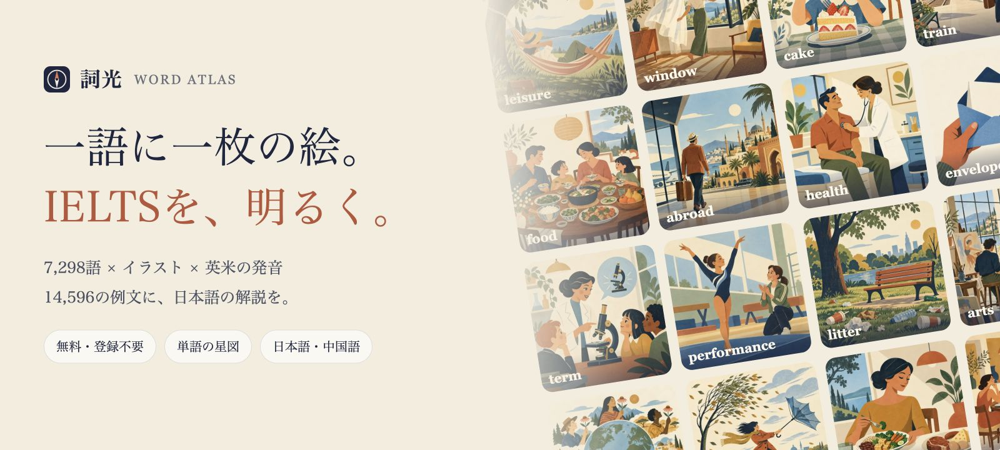
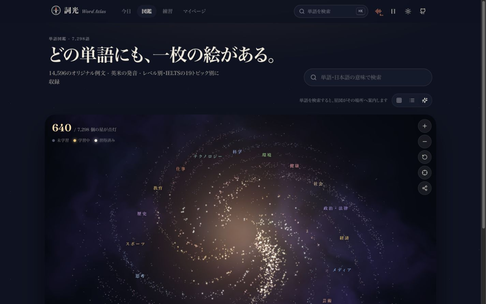

<div align="center">



# 詞光 · Word Atlas

**一語に一枚の絵、IELTSを照らす。**

IELTSの主要単語7,298語。それぞれにイラスト、2つの例文、英米の発音、忘れかけた頃に出会い直す復習の仕組みを。<br>
無料・オープンソース・登録不要。ブラウザーを開けば、すぐに学べます。

[**詞光を開く →**](https://kai987.github.io/IELTS-word-atlas/) &nbsp;·&nbsp; [▶ 日本語版の紹介動画](docs/assets/ja/launch.mp4) &nbsp;·&nbsp; [単語データ](data/) &nbsp;·&nbsp; 日本語 &nbsp;·&nbsp; [简体中文](README.zh-CN.md) &nbsp;·&nbsp; [English](README.en.md)

     

<a href="docs/assets/ja/launch.mp4"></a>

<sub>▶ 画像をクリックすると、日本語版の紹介動画を再生できます（音声付き）。</sub>

</div>

---

## 詞光について

単語学習で難しいのは、一度「見た」単語を、必要なときに「思い出す」こと。

単語帳に7,000語が並んでいても、最初のページから先へ進めないことがあります。詞光は、一語ごとに絵を添えて、まずその場面を**見る**ところから始めます。問題を解いて自分の力で**思い出し**、FSRSの間隔反復で、忘れかけた頃に**出会い直す**。覚えた単語は、あなただけの単語の星図で、一つずつ光り始めます。

このリポジトリは、[designfuchen/word-atlas](https://github.com/designfuchen/word-atlas) をもとにした日本語対応版です。元の単語解説・英語例文・イラスト・英語音声は、上流プロジェクトの作者が費用を負担して制作し、公開したものです。本フォークでは、画面と全7,298語の日本語化、訳文の意味の検証、日英中の文書整備、日本語の起動画面音声などを追加しています。

画面と単語の説明は、日本語と簡体字中国語に切り替えられます。言語ボタンの表示は「日」「中」。初回はブラウザーの優先言語に従い、中国語なら中国語、それ以外なら日本語で開きます。一度選んだ言語は端末に保存されます。英単語・英文例文・英語音声は、どちらの表示言語でも学習教材としてそのまま使います。

## 収録内容

| 数量 | 内容 |
|---:|---|
| **7,298** | IELTSの主要単語。CEFR A1〜C2、19のトピックに分類 |
| **7,298** | 統一したレトロな図鑑風イラスト。各単語の例文の場面を描写 |
| **14,596** | 英語のオリジナル例文。日常の短文とIELTSの文脈で使う長文に、中国語・日本語の訳を収録 |
| **22,905** | 英米の単語発音と例文の読み上げ音声 |
| **0** | アカウント・広告・トラッカー。学習の進捗は自分の端末に保存 |


## 絵と音で体験する

イラスト7,298枚、英語音声22,905本に、操作音・環境音・音楽を組み合わせています。ここでは、その一部を紹介します。

### 🖼 一語に一枚の絵

絵に描かれているのは、その単語の最初の例文の場面。全7,298語を通して、レトロな図鑑のような画風をそろえています。

<table>
<tr><td align="center" width="25%"><br><b>abandon</b> 捨てる；置き去りにする<br><sub><i>We had to abandon our car in the snow.</i></sub></td><td align="center" width="25%"><br><b>volcano</b> 火山<br><sub><i>We watched steam rising from the volcano across the lake.</i></sub></td><td align="center" width="25%"><br><b>orchestra</b> オーケストラ；管弦楽団<br><sub><i>The orchestra began playing as the lights dimmed.</i></sub></td><td align="center" width="25%"><br><b>telescope</b> 望遠鏡<br><sub><i>We watched the moon through a telescope on the balcony.</i></sub></td></tr>
<tr><td align="center" width="25%"><br><b>migrate</b> 移住する；渡りをする<br><sub><i>These birds migrate south when the weather turns cold.</i></sub></td><td align="center" width="25%"><br><b>festival</b> 祭り；祝祭<br><sub><i>Our town holds a lantern festival every autumn.</i></sub></td><td align="center" width="25%"><br><b>lighthouse</b> 灯台<br><sub><i>The lighthouse beam swept across the dark sea.</i></sub></td><td align="center" width="25%"><br><b>astronaut</b> 宇宙飛行士<br><sub><i>The astronaut floated gently through the small space station.</i></sub></td></tr>
</table>

### 🔊 単語も例文も、音で確かめる

*abandon* の音声は、以下のリンクから再生できます。

| | |
|---|---|
| 🇬🇧 イギリス英語 | [abandon /əˈbændən/](https://kai987.github.io/IELTS-word-atlas/atlas/audio/uk/abandon.mp3) |
| 🇺🇸 アメリカ英語 | [abandon /əˈbændən/](https://kai987.github.io/IELTS-word-atlas/atlas/audio/us/abandon.mp3) |
| 📖 例文の読み上げ | [We had to abandon our car in the snow.](https://kai987.github.io/IELTS-word-atlas/atlas/audio/ex/abandon.mp3) |

全7,298語に英米の発音と例文音声を収録しています。さらに1,011語では、2つ目の例文も音声で聞けます。

### 🎧 学習に寄り添う音

| | |
|---|---|
| 🎙 **日本語の起動画面音声** | [「IELTSへの扉を開こう」](https://kai987.github.io/IELTS-word-atlas/sfx/splash-voice-ja-morioki.mp3)。AivisSpeechのmoriokiで合成。星の粒子が「詞光」の文字を形づくり、扉が開きます |
| 🌌 **星図の音声案内** | [元の中国語音声](https://kai987.github.io/IELTS-word-atlas/sfx/voice-galaxy-hello.mp3)。「あなたの単語の星図です。一語覚えるたびに、星が一つ灯ります」という内容です |
| 🎵 **星空の音楽** | [途切れずループするBGM](https://kai987.github.io/IELTS-word-atlas/sfx/amb-stars.mp3) |
| 🌧 **6種類の環境音** | [雨の図書館](https://kai987.github.io/IELTS-word-atlas/sfx/amb-rain.mp3) · [早朝の海岸](https://kai987.github.io/IELTS-word-atlas/sfx/amb-sea.mp3) · [森の朝](https://kai987.github.io/IELTS-word-atlas/sfx/amb-forest.mp3) · [夜の暖炉](https://kai987.github.io/IELTS-word-atlas/sfx/amb-fire.mp3) · [航海中の船室](https://kai987.github.io/IELTS-word-atlas/sfx/amb-voyage.mp3) · [静かなカフェ](https://kai987.github.io/IELTS-word-atlas/sfx/amb-cafe.mp3) |
| ✨ **操作音** | 正解・不正解、カードの切り替え、タイピング、連続正解、星の点灯などに合わせた音。単語を読み上げるときは、背景音を自動で小さくします |

素材はリポジトリに同梱しています。イラストは `public/atlas/img/`、英語音声は `public/atlas/audio/` にあり、これらはCC BY 4.0で公開しています。操作音・環境音・音楽は `public/sfx/` にあります。

## 一つの単語に収録しているもの

| | |
|---|---|
| 🖼 **イラスト1枚** | 最初の例文の場面を描きます。抽象的な語も具体的な場面で表現。たとえば *abandon* は、雪の中に置き去りにされた車です |
| 🔊 **英米の発音** | イギリス英語とアメリカ英語をそれぞれ合成。例文の読み上げも収録しています（ElevenLabsのAI音声） |
| ✍️ **英語例文2文** | 日常の短文と、教育・環境・技術・都市などIELTSの文脈で使う長文。中国語と日本語の訳付き |
| 📚 **意味と英語の定義** | 主な意味を最大3つ収録。簡潔な英語の説明に、中国語または日本語の訳を添えています |
| 🧩 **コロケーション・語族・類義語・対義語** | よく使う語の組み合わせに訳を付け、関連する語のカードへ移動できます |
| 💡 **使い方のヒント** | 混同しやすい語、用法上の注意、覚え方を紹介します |


## あなただけの単語の星図



<sub>画面はデモ用の学習データです。実際の進捗は、それぞれの端末に保存されます。</sub>

7,298語が、7,298個の星に。19のトピックが銀河の腕を形づくり、やさしい語は中心に、難しい語は外側に並びます。未学習の語は星の粒子、学習中の語は光る星、習得した語は白い星、今日覚えた語は金色の星として表示します。ドラッグで回転、スクロールで拡大・縮小し、星をクリックすると単語カードを開けます。

星図はWebGL2の独自シェーダーで描画し、対応していない端末では表示方法を切り替えます。

<p align="center"><a href="docs/assets/ja/demo.mp4"><b>▶ 日本語版の画面ガイドを見る</b></a></p>

日本語版の画像・動画は、実際の日本語画面を使って制作しています。紹介動画（約45秒）と画面ガイド（約28秒）は、画面キャプチャに動きと日本語字幕を加えたものです。紹介動画にはBGMと日本語の起動メッセージ、画面ガイドにはBGMのみを使用しています。[メディアの制作情報](docs/assets/ja/README.md)も公開しています。

## 記憶を支える仕組み

- **自分で思い出す練習**：意味から単語を選ぶ、絵を見て英文を完成させる、音を聞いて選ぶ、スペルを入力する。4つの形式で、「見ればわかる」から「自分で書ける」へ。
- **FSRSによる間隔反復**：新しいAnkiにも採用されているオープンソースの記憶アルゴリズムを使用。忘れかける頃に復習し、目標とする記憶保持率を調整できます。
- **最初の解答を記録**：正答率に数えるのは初回の解答だけ。間違えた語は別の形式で再登場しますが、再解答で正答率が上がることはありません。
- **自分のレベルから開始**：A2・B1・B2・C1から開始レベルを選び、すでに慣れている語を飛ばせます。
- **タイピング練習**：単語、例文の書き写し、英文のディクテーションの3モード。WPMと正確さは別に記録し、単語の記憶データには影響しません。
- **穏やかな音**：木琴、紙、ベルを思わせる操作音に、星空の音楽と6種類の環境音。英語音声の再生中は背景音が小さくなります。
- **一日の始まりのアニメーション**：星の粒子が「詞光」を形づくり、「IELTSへの扉を開こう」の声とともに扉が開きます。一日一回表示され、設定で無効にもできます。
- **オフラインでも復習**：一度表示した単語、イラスト、音声を端末にキャッシュします。
- **シェアカード**：単語や一日の学習成果を、画像として保存できます。
- **バックアップと復元**：進捗をファイルに書き出し、別の端末で読み込めます。

<table>
<tr>
<td width="62%"></td>
<td></td>
</tr>
</table>

## 自由に使える単語データ

単語データは **CC BY 4.0** で公開しています。クレジットとライセンスを表示し、変更した場合はその旨を明記すれば、利用・改変・商用利用ができます。

| ファイル | 内容 |
|---|---|
| [`data/word-atlas.json`](data/word-atlas.json) | 元の英語・中国語の全件データ |
| [`data/word-atlas.csv`](data/word-atlas.csv) | 元の英語・中国語の表形式データ。ExcelやAnkiへの取り込みに |
| [`data/ja/entries/`](data/ja/entries/) | 全7,298語の日本語訳のソース。元の単語ID・順序・配列の対応を維持 |
| [`public/atlas/ja/`](public/atlas/ja/) | ウェブ用の日本語分割データ、検索ラベル、元データのハッシュ |
| `public/atlas/img/` | 512pxのWebPイラスト7,298枚。`public/atlas/thumb/` に256pxのサムネイル |
| `public/atlas/audio/` | `uk/`・`us/` に単語の発音、`ex/`・`ex2/` に例文の読み上げ（MP3） |

日本語のファイルは、英語・中国語の全件データに重ねて使う翻訳データです。`senses` と `ex` は元データの各項目に対応する日本語の配列です。以下は `principle` の日本語データです。

```json
{
  "id": "principle",
  "senses": [
    "判断や行動の指針となる信念や規則；原則",
    "物事の仕組みを説明する基本的な真理；原理"
  ],
  "ex": [
    "私は信条に照らして、余分なお金を断りました。",
    "高等教育を受ける機会を広げる政策は、機会均等の原則に基づくべきです。"
  ],
  "col": [
    "basic principle｜基本原則；基本原理",
    "in principle｜原則として；理論上",
    "on principle｜信条に基づいて",
    "guiding principle｜指針となる原則"
  ],
  "tip": "「主要な」や「校長」を意味するprincipalと混同しないようにします。",
  "note": ""
}
```

元の英語・中国語データは、Pythonでもすぐに読み込めます。

```python
import json
words = json.load(open("data/word-atlas.json", encoding="utf-8"))
b2_env = [w for w in words if w["cefr"] == "B2" and w["topic"] == "environment"]
```

Ankiデッキ、単語学習アプリ、ブラウザー拡張、AIアプリの評価用データ、研究などに活用できます。元データのフィールドは [docs/dataset.md](docs/dataset.md)、日本語データの構造と組み立て方は [docs/japanese.md](docs/japanese.md) に記載しています。

## ローカルで起動する

Node.js 20以降が必要です。

```bash
git clone https://github.com/kai987/IELTS-word-atlas.git
cd IELTS-word-atlas
npm ci
npm run dev
```

`http://localhost:5188` を開きます。同じWi-Fiにつながったスマートフォンでは、ターミナルに表示されるNetworkアドレスからアクセスできます。

```bash
npm test             # 単体テスト
npm run test:ja-review # 日本語の翻訳・レビュー処理のテスト
npm run check:atlas  # 単語データとメディアの構造検証
npm run check:japanese # 日本語データ、元データとの対応関係の検証
npm run build        # 本番用ビルド。出力先は dist/
```

`dist/` を静的ホスティングに配置して公開できます。サブパスへの配置は `ATLAS_BASE=/IELTS-word-atlas/ npm run build` のように指定します。GitHub Pagesを含む手順は [docs/deployment.md](docs/deployment.md) を参照してください。

## コンテンツの制作と日本語化

元の見出し語一覧は、IELTSリーディングの主要語から重複を除いた7,298語です。上流プロジェクトでは、次の方法で内容を制作しています。

1. **文章**：統一した辞書作成仕様に沿って、大規模言語モデルが単語ごとに意味・例文・コロケーション・ヒントを作成し、構造と整合性を検証。
2. **イラスト**：画像生成モデルが統一した画風で、一語ずつ最初の例文に対応する場面を描画。
3. **音声**：ElevenLabsで英米の発音と例文音声を合成。操作音・環境音も上流プロジェクト向けに制作。

本フォークの日本語化では、英語と中国語の両方がある意味・例文・コロケーションは**英語を主な原文として**翻訳し、中国語だけのヒント・注記は**中国語から**翻訳しています。英文・英単語・発音記号を保持し、単語ごとの文脈と原文に照らして訳文を確認します。独立した全件の意味の検証と疑義の再検証で確定した修正は、公開用データにも反映しています。経緯は [日本語対応の説明](docs/japanese.md) と [修正適用記録](docs/ja-focused-corrections-2026-10-28.md) に残しています。

日本語の起動画面音声は、AivisSpeech（morioki・ノーマル）で作成しました。ウェブサイトの利用時に翻訳APIやローカル言語モデルを動かす必要はありません。

生成スクリプトは [`scripts/atlas/`](scripts/atlas)、元の制作フローは [docs/pipeline.md](docs/pipeline.md)、学習アルゴリズムは [docs/learning-model.md](docs/learning-model.md) を参照してください。

> **精度について**：構造・参照関係・整合性の自動検証や意味のレビューは、専門家による全件の人手校閲や、誤りがないことの保証を意味しません。意味・訳・例文・イラストに不正確な点が残る可能性があります。問題を見つけた場合は、単語IDと該当箇所をIssueでお知らせいただくか、データを修正したPRをお送りください。IELTS公式の単語リストではなく、スコア向上を保証するものでもありません。

## コントリビュート

- **誤りの修正**：単語IDと問題のある箇所をIssueに記載するか、PRを作成してください。
- **機能の提案**：まずIssueで相談してください。「登録不要・ローカル優先・静かで見やすい」という方向を大切にしています。
- **コード**：TypeScriptの厳格モードを使用。`npm test`、`npm run test:ja-review`、`npm run check:atlas`、`npm run check:japanese` が通ることを確認してください。

詳しくは [CONTRIBUTING.md](CONTRIBUTING.md) を参照してください。

## ライセンスとクレジット

- 元プロジェクト：[designfuchen/word-atlas](https://github.com/designfuchen/word-atlas)。本リポジトリは、その日本語対応版です。
- コード：[MIT](LICENSE)
- 単語データ・イラスト・英語音声：[CC BY 4.0](CONTENT_LICENSE.md)。クレジットは `Word Atlas contributors — CC BY 4.0` とし、ライセンスへのリンクと変更の有無を明記してください。
- 英語の合成音声：ElevenLabs（イギリス英語：Alice、アメリカ英語：Sarah）。日本語の起動画面音声：AivisSpeech（morioki）。完成音声の利用は、音声モデルや声の権利の譲渡、提供元による推奨を意味しません。
- Frauncesフォント：SIL Open Font License。記憶アルゴリズム [ts-fsrs](https://github.com/open-spaced-repetition/ts-fsrs)：MIT。

## Starの推移

[](https://star-history.com/#kai987/IELTS-word-atlas&Date)

<div align="center">

詞光が学習の役に立ったら、⭐️で応援していただけるとうれしいです。

</div>
